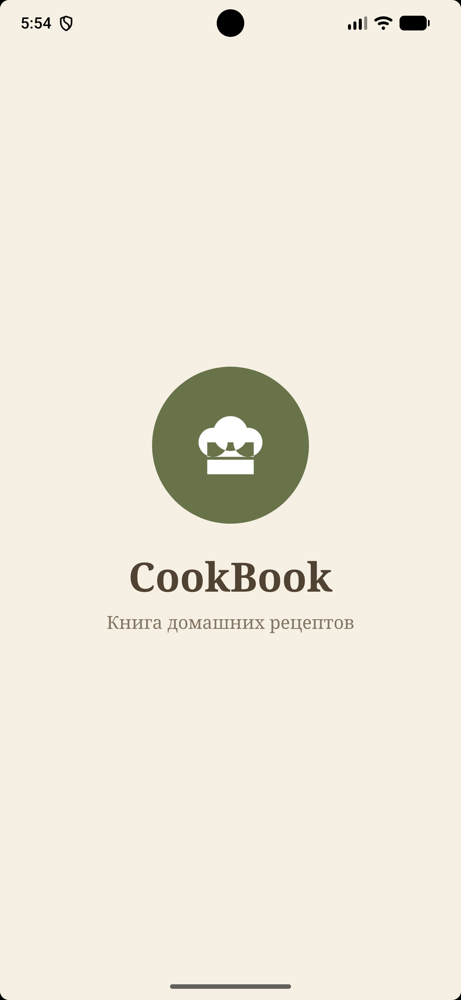
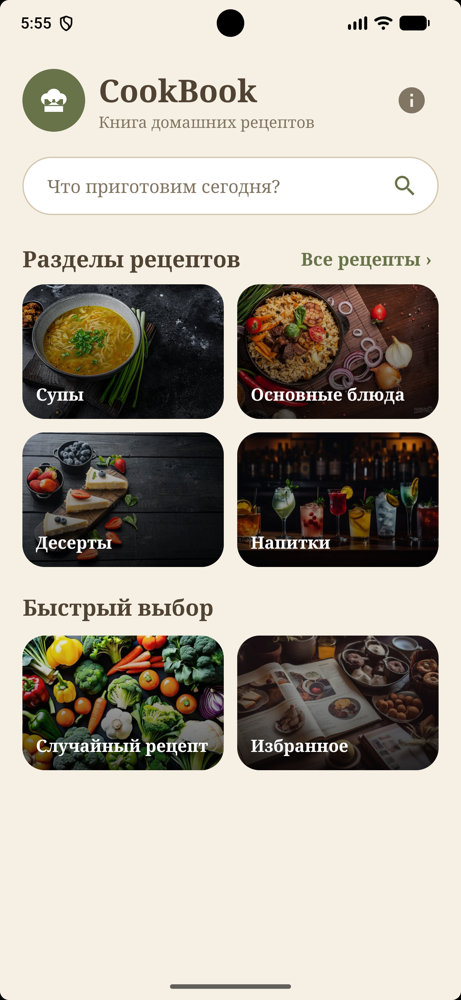
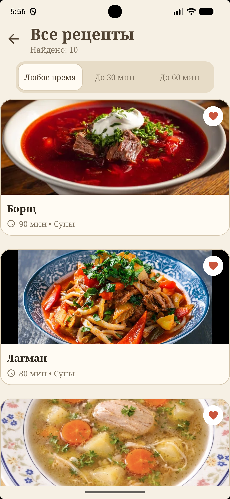
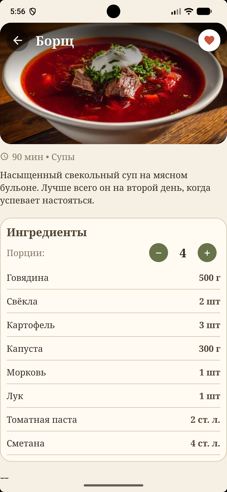
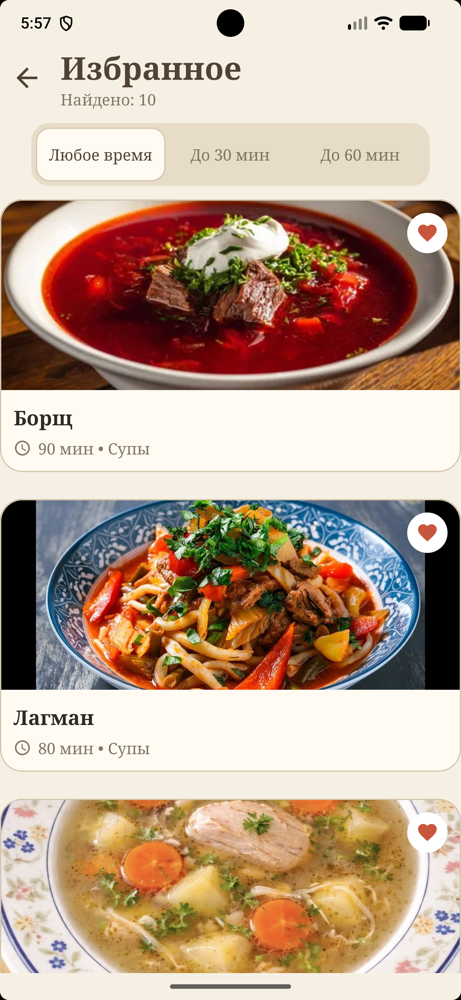
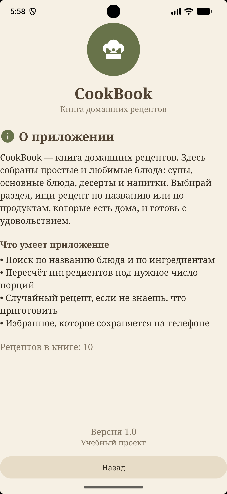

# CookBook

Приложение для Android со сборником домашних рецептов. Можно выбрать раздел, найти блюдо, посмотреть ингредиенты и шаги приготовления.

Учебный проект по дисциплине "Разработка мобильных приложений".

## Что есть в приложении

- 10 рецептов в четырёх разделах: супы, основные блюда, десерты, напитки
- поиск по названию и по продуктам
- фильтр по времени приготовления
- пересчёт ингредиентов под нужное число порций
- случайный рецепт
- избранное, которое остаётся после закрытия приложения

## Экраны

Заставка, главная, список рецептов, карточка рецепта, о приложении. Переходы между ними сделаны через явные Intent.

## Версии

- Kotlin, интерфейс на XML
- minSdk 26 (Android 8.0)
- targetSdk 37
- compileSdk 37
- Проверено на виртуальном устройстве Pixel 7 Pro, версия Android 17.0

## Скриншоты

     

## Ссылки

- [APK-файл](https://github.com/GEAT-keer/CookBook/releases/latest)
- [Логи](logs/logs.txt)

Автор: Низамутдинов Ильхам, группа по практике: среда в 8:55.